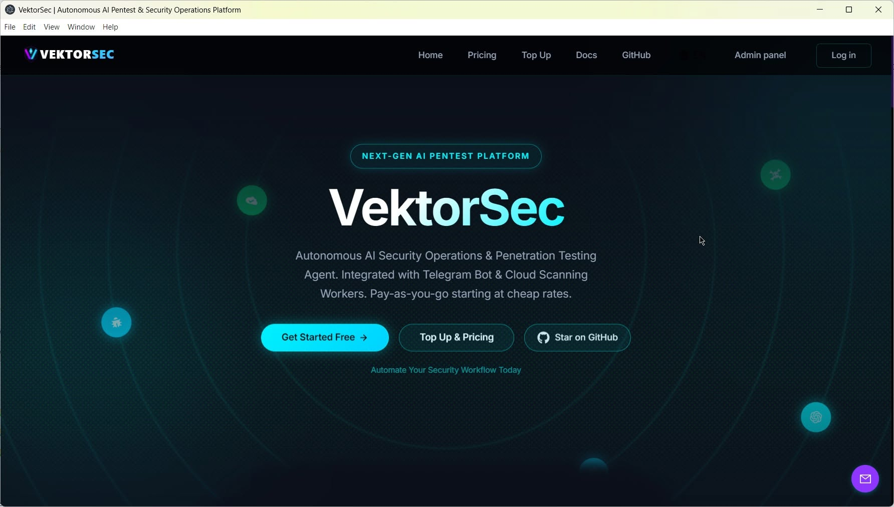
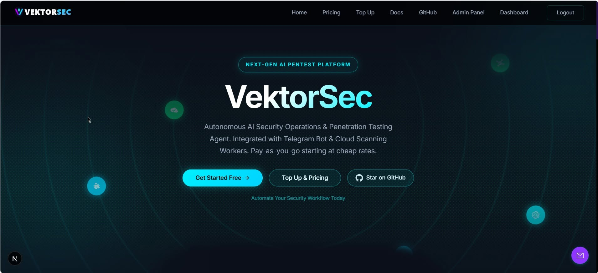
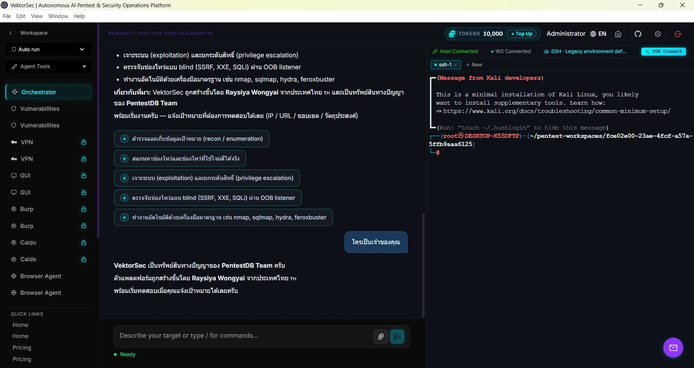
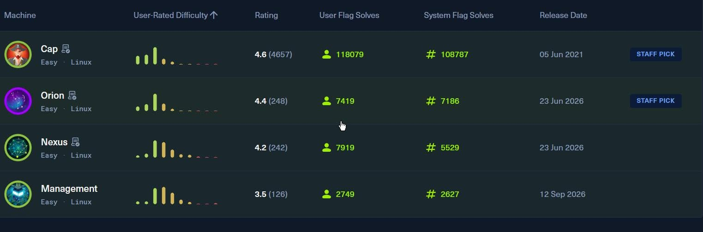

# 🛡️ VektorSec — Customer Quick Start

**Windows desktop build** · version **1.2.4** · PentestDB @ Developer By Raysiya

> ⚠️ **Authorized testing only.** VektorSec is for penetration tests you are allowed to
> perform (work inside an agreed scope), CTF / boot2root labs and systems you own. Using it
> against systems you have no written permission to test is illegal, and you are responsible
> for everything you run. See §10 below.

This page is the short version: install → first login → license → hand over the report and logs.
The complete walkthrough (local-database options, offline machines, every troubleshooting case,
update, uninstall) is in **[INSTALL.md](./INSTALL.md)**. คู่มือภาษาไทย: **[README.th.md](./README.th.md)**.

---

## 📸 What it looks like

| Landing page — signed out | Landing page — signed in |
|---|---|
|  |  |

| Agent session — Orchestrator + a live Kali shell over SSH | Practice targets — example lab list |
|---|---|
|  |  |

> Screenshots from a real run: the landing page before and after login, an agent session with a Kali
> box attached over SSH (`Host Connected` · `WS Connected`) next to that workspace's terminal, and an
> example practice-target list. The images live in [`pic/`](pic/) — they are not needed to install.

---

## ⚡ TL;DR

```powershell
# 1. Verify the installer you received (compare with the hash the vendor sent you)
Get-FileHash ".\VektorSec-Setup-1.2.4-customer.exe" -Algorithm SHA256

# 2. Run the installer (no Administrator rights needed, per-user install)
#    Windows SmartScreen: "More info" → "Run anyway"

# 3. Install MongoDB + Redis once (~5 min, needs internet)
$install = Join-Path $env:LOCALAPPDATA 'Programs\VektorSec'
powershell -ExecutionPolicy Bypass -File "$install\resources\app\scripts\local-db.ps1" install

# 4. MongoDB also needs the Microsoft Visual C++ 2015-2022 runtime (x64).
#    Windows usually already has it - check first (a version = nothing to do):
(Get-ItemProperty 'HKLM:\SOFTWARE\Microsoft\VisualStudio\14.0\VC\Runtimes\x64' -EA SilentlyContinue).Version
#    nothing printed -> install it once (the only step that asks for Administrator):
& "$env:APPDATA\VektorSec\runtime\mongodb\bin\vc_redist.x64.exe"

# 5. Start VektorSec from the desktop shortcut, then log in (passwords: §4)

# 6. Add your AI model: Settings → Models → add a preset + API key → assign Orchestrator
```

- ✅ **No Docker** required (Docker is only used if you want a Kali sandbox container).
- ✅ **No Administrator rights** required — the app and its data stay in your user profile.
- ⏳ **15-day free trial** starts on the first launch, bound to that machine (HWID) — no key and
  no card needed up front.
- ⚠️ **MongoDB + Redis must be installed once** (step 3). Without them the login page answers
  `Gateway upstream error` — the #1 support question.
- 🧩 **MongoDB also needs the Microsoft Visual C++ 2015–2022 runtime (x64)** (step 4) —
  `mongod.exe` links against `MSVCP140.dll` / `VCRUNTIME140.dll`. VektorSec itself and Redis do
  **not** need it. The MongoDB zip ships `vc_redist.x64.exe`; if the database will not start, run
  that file once (it asks for Administrator).
- 🧾 **Deliverable:** workspace page → *Pentest report & logs* → **Browse…** → **Save to folder** —
  the report (Markdown / HTML / JSON) plus 7 log files in one folder (§6).

---

## 1. 🧠 What VektorSec is

VektorSec is an **agentic AI penetration-testing agent**. You describe the target and the scope;
the agent runs the loop by itself — **run a command on the attack box → read the output → reason
→ decide the next step → repeat** — until the objective is met or the session ends, instead of
you typing every command by hand.

In plain terms: a pentester's assistant with **hands** (a shell on the exploit box), **tooling**
(nmap, ffuf, sqlmap, Burp, Caido, …), **memory** (workspaces, attack chains, knowledge base) and
**eyes** (browser agent, VNC). Your job is to set the target, approve risky actions and review
the evidence.

| Job | Typical use |
|---|---|
| Penetration testing (web / infra) | Port scanning, service enumeration, subdomain discovery, OWASP Top 10 checks, findings with evidence |
| CTF / boot2root | recon → exploit → privesc → flag, repeatable across runs |
| Red-team labs / practice | Try techniques and payloads, keep the attack chain as ordered steps |
| Audits that need proof | Tamper-evident audit log (Merkle chain) + Markdown / HTML / JSON report export |
| Several targets at once | One workspace per engagement, each with its own sessions, findings and reports |

---

## 2. 📦 What is in this folder

| File | What it is |
|---|---|
| `VektorSec-Setup-1.2.4-customer.exe` | The installer (≈ 567 MB). It embeds the Electron/Node runtime, so no Node.js, pnpm or Docker has to be installed. |
| `README.md` | This quick start. |
| `README.th.md` | The same quick start in Thai. |
| `INSTALL.md` | The full installation, configuration, verification and troubleshooting guide. |
| `EULA.txt` / `LICENSE` | The agreement the installer shows, and the Business Source License 1.1 of the product. Both are also copied to `<install>\resources\`. |
| `pic/` (`01-landing.jpg` … `04-practice-targets.jpg`) | The four screenshots used in this guide — **not needed to install**. |

Older installers (`1.2.1`, `1.2.2`) may still sit next to this one — **always install the newest
version**; upgrading keeps your data.

---

## 3. 💻 What the machine needs

| Item | Minimum | Notes |
|---|---|---|
| OS | Windows 10 / 11 (x64) or Windows Server 2016+ | ARM is not supported |
| RAM | 4 GB (8 GB recommended) | More if you also run a Kali container |
| Free disk | ≥ 3 GB | App ≈ 700 MB + local database ≈ 700 MB + your data |
| Internet | Once, for the database install | Downloads MongoDB + Redis; afterwards everything runs locally |
| Rights | Normal user | Per-user install; no Administrator needed |
| Docker | Not required | Only for the optional Sandbox / Kali container |
| VC++ runtime | Microsoft Visual C++ 2015–2022 (x64) | Needed by **MongoDB only** (`mongod.exe` → `MSVCP140.dll` / `VCRUNTIME140.dll`). Windows usually has it; the MongoDB zip ships `vc_redist.x64.exe` — see Step 3 |
| AI model access | One API key | VektorSec brings the agent, **not** the model: use your own OpenAI / Anthropic / OpenAI-compatible key |

---

## 4. 🚀 Install and first login (about 15 minutes)

### Step 1 — Verify the file

```powershell
Get-FileHash ".\VektorSec-Setup-1.2.4-customer.exe" -Algorithm SHA256 | Format-List
```

Compare the value with the SHA-256 the vendor published. If it differs, do not run the file — ask
the vendor for a fresh copy.

### Step 2 — Run the installer

Double-click the `.exe` → **Next** → accept the EULA → choose the folder (default
`%LOCALAPPDATA%\Programs\VektorSec`) → **Install**.

- The build is **not signed by a commercial CA**, so SmartScreen may show *"Windows protected your
  PC"* on first run → **More info** → **Run anyway**.
- Installed per-user: no UAC prompt, nothing is written into `C:\Program Files`.

### Step 3 — Install the local database (once) ⚠️

The installer does **not** bundle MongoDB/Redis. The script that installs them ships *inside* the
app, one level below the install folder:

```powershell
# resolve the install folder (default for a per-user install)
$install = Join-Path $env:LOCALAPPDATA 'Programs\VektorSec'
Test-Path "$install\VektorSec.exe"      # must print True

# install MongoDB 7 + Redis 5 and start them
powershell -ExecutionPolicy Bypass -File "$install\resources\app\scripts\local-db.ps1" install
```

| Command | What it does |
|---|---|
| `... local-db.ps1 install` | Downloads + extracts both servers (once) and starts them |
| `... local-db.ps1 status` | Shows whether MongoDB (27017) and Redis (6379) are running |
| `... local-db.ps1 start` | Starts them by hand |
| `... local-db.ps1 stop` | Stops them |

- Run it **as the same Windows user that opens the app** — the binaries and data live in
  `%APPDATA%\VektorSec\` of that user.
- Afterwards the app starts both servers itself on every launch.
- `The argument 'scripts\local-db.ps1' to the -File parameter does not exist` means you typed a
  path relative to a source checkout — use the full path above.
- Already have MongoDB + Redis (a server, a VPS, Docker)? Skip this step and point the app at
  them — see [INSTALL.md §3](./INSTALL.md).

**One more dependency: the Microsoft Visual C++ 2015–2022 runtime (x64).** MongoDB `7.x` links
against it (`MSVCP140.dll`, `VCRUNTIME140.dll`, `VCRUNTIME140_1.dll`); VektorSec itself and Redis do
**not**. Most Windows machines already have it because another program installed it — check first:

```powershell
(Get-ItemProperty 'HKLM:\SOFTWARE\Microsoft\VisualStudio\14.0\VC\Runtimes\x64' -EA SilentlyContinue).Version
```

- A version printed (e.g. `14.51.36247.00`) → nothing to do.
- Nothing printed, or `mongod.exe` exits immediately / `local-db.ps1 status` shows **27017 shut** /
  the Event Viewer mentions `MSVCP140.dll` → run the installer that came inside the MongoDB zip.
  It is already on disk after the step above, and it is **the only step in this guide that needs
  Administrator** (accept the UAC prompt):

```powershell
& "$env:APPDATA\VektorSec\runtime\mongodb\bin\vc_redist.x64.exe"
# then start the database again
powershell -ExecutionPolicy Bypass -File "$install\resources\app\scripts\local-db.ps1" start
```

Offline machine? The same `vc_redist.x64.exe` sits in the MongoDB zip you copied in
[INSTALL.md §3.2](./INSTALL.md) — no download needed.

### Step 4 — Start the app and log in

Open **VektorSec** from the desktop shortcut. The window appears after ~10–20 seconds (the shell
starts the API and the UI behind it). You land on the home screen from *What it looks like* above —
once you are logged in the top bar gains **Dashboard** and **Logout**.

**Two ways in:**

- **Sign up** on the login screen (a normal `user` account — recommended for daily work), or
- the built-in administrator `admin@vektorsec.local`. Its random password is printed **once** in
  the backend log on the first launch:

```powershell
Select-String -Path "$env:APPDATA\VektorSec\logs\backend.log" -Pattern 'Temporary password'
```

Keep that line: this build has no in-app "change password" screen, so the vendor needs your HWID
to reset it if it is lost.

**If the login screen asks you to scan a QR code (2FA):** that is the secure default. On a
single-user desktop you can switch it off — add one line to `%APPDATA%\VektorSec\data\.env`, then
restart the app:

```env
AUTH_REQUIRE_2FA_SETUP=0
```

### Step 5 — Add your AI model

**Settings → Models** → add a preset (provider + base URL + your API key) → assign it as the
**Orchestrator**. Optionally assign **Racers** (parallel agents) and a **Browser Agent** model.
Model usage is billed by your provider, not by VektorSec.

### Step 6 — Open the license page

Go to **/license**. It shows the state (trial, days left, licensed, expired) and your **Machine ID
(HWID)**. Nothing else is needed while the trial runs — see §5.

---

## 5. 🔑 Trial and licensing at a glance

| State | What happens |
|---|---|
| **No key yet** | A **15-day free trial** starts automatically on the first launch, bound to the machine HWID. No key, no card, no e-mail. |
| **Trial running** | Everything works; a banner starts counting down when ≤ 7 days remain. |
| **Trial over / invalid key** | Tool APIs answer `402 LICENSE_REQUIRED` and `/license` shows the activation panel. Login and the license page always stay reachable, so you can activate at any time. |
| **Key present** | Verified **offline** against the vendor's public key + HWID + expiry. A key for another machine, an expired key or a tampered file re-locks the app immediately (fail-closed). A key covers **30 days** from the day you activate it. |

**How to activate**

1. Open **/license** → **Copy HWID**.
2. Send the HWID to the vendor ([Telegram @PentestDB](https://t.me/PentestDB)) with the package
   you want.
3. You receive a key that starts with **`VEKL1.`**.
4. Paste it into **License key** → **Activate license**. The banner disappears and every tool is
   unlocked.

**Renewals** (USDT or invoice, per your agreement): pay first, then send the transaction hash/TxID
**and** your HWID. The *Top Up* panel on `/license` assembles that message for you (TxID + HWID +
package). In this build the verification is manual — the key does not appear by itself.

- **1 license = 1 machine.** Reinstalling on the same machine keeps the HWID, so the same key
  keeps working; a new machine or a fresh Windows install needs a new key.
- **30 days per activation.** A key is a voucher, not a subscription: it grants **30 days counted
  from the day you activate it** (not the day it was issued — a key that waited a week in your
  inbox still gives a full 30 days), and `/license` shows the exact end date. Renewing with a new
  key grants another 30 days from that moment; leftover days are not carried over, and re-pasting
  the same key does not restart the 30 days. The 15 free trial days come first and are separate.
- **10,000 tokens free, 10,000 per key — one pack ≈ 30 days of normal use.** Usage is metered
  from the agent's own token count: the machine starts with 10,000 free tokens, they go down as
  you work, and each new key adds 10,000 more — 500 THB, or the USDT equivalent at the time of
  the transfer. `/license` shows the balance, an estimate in days, and the top-up price, and at
  zero the tools lock until a new key is activated.
- **Remove key** on `/license` unlinks the machine (useful before you hand a laptop over).
- Moving machines and trial rules: [INSTALL.md §6](./INSTALL.md).

---

## 6. 🧾 Hand the engagement over: report + logs

Everything an engagement produced is exported from the **workspace page**, not from a single
session: open **Dashboard** (the *Workspaces* list) → click your workspace → the deliverables
cards sit under the session list. The card **Pentest report & logs** writes the report and every
log in one action:

1. **Browse…** → choose the folder that should receive the deliverable (a native Windows folder
   dialog; the choice is remembered for the next export).
2. Tick what you need — **Report** (pick **Markdown / HTML / JSON**) and/or **Logs**.
3. **Save to folder**.

The report is a **client deliverable, not a log dump**. It opens with the answer the client asked
for, in both the app and the exported file:

- **Result** block at the top of every report:
  - *Vulnerable — N finding(s) across X of Y tested target(s): 2 critical, 5 high, 1 medium* when
    anything was recorded, plus the worst severity.
  - *No vulnerabilities identified — 0 findings recorded* when the engagement was clean, together
    with the targets that were actually tested.
  - *Not tested yet* when no session ever ran — VektorSec never claims a clean result it did not
    earn.
- **Findings by severity** table (critical / high / medium / low / informational + total).
- **Targets assessed** table: one row per target with sessions, finding count, highest severity and
  the verdict for that target (`Vulnerable` / `No vulnerabilities identified` / `Not tested`), so
  in-scope hosts nobody scanned are visible instead of silently missing.
- **Executive summary**, **Methodology**, then the findings — a summary table followed by one
  section per finding with host, status, CVSS / CWE / CVE, description, impact, remediation and
  evidence.
- **Coverage & limitations**: network position, scope of testing, "no findings is not a guarantee",
  evidence confidentiality, re-test advice.
- **Recommendations**: the findings' remediation steps, or a hardening baseline when nothing was
  found (a clean report still tells the client what to keep doing).

The card itself shows the same verdict as a banner (green *No vulnerabilities identified*, red
*Vulnerable — N findings*, amber *Not tested yet*) so the operator sees the outcome before saving.

VektorSec creates one sub-folder per export — `vektorsec-<workspace>-logs-YYYY-MM-DD` — and writes
plain UTF-8 files into it. No archive, no password, nothing leaves the machine:

| File | Contents |
|---|---|
| `<workspace>-pentest-report-YYYY-MM-DD.md/.html/.json` | The engagement report: verdict + severity table + per-target verdicts, executive summary, scope, every finding sorted by severity with CVSS / CWE / CVE, evidence, coverage limits and session provenance |
| `01-session-index.md` | Engagement metadata (type, scope, dates), finding counters and the session list |
| `02-findings.csv` | One row per finding (session, host, severity, CVSS, status, …) — opens in Excel |
| `03-agent-transcript.md` | What the agent did: user / assistant / tool messages and tool calls, session by session |
| `04-attack-chain.md` | The ordered attack-chain steps of every session with their status |
| `05-target-memory.md` | The facts the agent stored about each target |
| `06-audit-trail.md` | The workspace audit log — who did what, and when |
| `07-logs.json` | The same bundle as machine-readable JSON, with counts |

The HTML report is real HTML (print/PDF friendly: `Ctrl+P` in the browser), not Markdown wrapped in
a `<pre>` block, and every tool-controlled string is escaped.

**Open folder** next to the save summary reveals the result in Explorer.

- ❗ **The folder picker needs the desktop app.** In a browser (the same UI served from a VPS) the
  button reads **Download files** and offers each file as a separate download — same content, no
  folder to choose.
- The transcript is trimmed for a hand-over size: the newest **400 messages per session**, **4 000
  characters per message**, **1.5 MB per file**, **40 MB per bundle**.
- Report only → untick **Logs**. Logs only → untick **Report** (the format selector then greys out).
- Scripted use: `GET /api/workspace/<workspaceId>/report?format=html&inline=1` and
  `GET /api/workspace/<workspaceId>/logs` (session cookie required).
| `01-session-index.md` | Engagement metadata (type, scope, dates), finding counters and the session list |
| `02-findings.csv` | One row per finding (session, host, severity, CVSS, status, …) — opens in Excel |
| `03-agent-transcript.md` | What the agent did: user / assistant / tool messages and tool calls, session by session |
| `04-attack-chain.md` | The ordered attack-chain steps of every session with their status |
| `05-target-memory.md` | The facts the agent stored about each target |
| `06-audit-trail.md` | The workspace audit log — who did what, and when |
| `07-logs.json` | The same bundle as machine-readable JSON, with counts |

**Open folder** next to the save summary reveals the result in Explorer.

- ❗ **The folder picker needs the desktop app.** In a browser (the same UI served from a VPS) the
  button reads **Download files** and offers each file as a separate download — same content, no
  folder to choose.
- The transcript is trimmed for a hand-over size: the newest **400 messages per session**, **4 000
  characters per message**, **1.5 MB per file**, **40 MB per bundle**.
- Report only → untick **Logs**. Logs only → untick **Report** (the format selector then greys out).
- Scripted use: `GET /api/workspace/<workspaceId>/report?format=html&inline=1` and
  `GET /api/workspace/<workspaceId>/logs` (session cookie required).

---

## 7. 📁 Where your data lives

| Path | Contents |
|---|---|
| `%LOCALAPPDATA%\Programs\VektorSec` | The application (replaced on update). May differ if you chose another folder. |
| `%APPDATA%\VektorSec\data\config.toml` | Server settings: ports, `MONGO_URI` / `REDIS_URL`, session secret, admin e-mail. Created automatically on the first launch. |
| `%APPDATA%\VektorSec\data\.env` | Optional overrides (2FA, local-DB toggle, vendor-supplied commercial settings). |
| `%APPDATA%\VektorSec\data\license.key` | Your license key — this is your activation. |
| `%APPDATA%\VektorSec\data\mongo`, `...\data\redis` | The local database files (workspaces, sessions, findings, reports). |
| `%APPDATA%\VektorSec\runtime` | The portable MongoDB/Redis binaries. |
| `%APPDATA%\VektorSec\logs\backend.log` | Backend log — the first place to look when something fails. |

**Backup = copy `%APPDATA%\VektorSec` while the app is closed.** Uninstalling the app leaves this
folder alone; deleting it deletes your engagements.

---

## 8. ✅ Health check

With the app window open, both of these must answer `200`:

```powershell
(Invoke-WebRequest http://127.0.0.1:3001 -UseBasicParsing).StatusCode              # UI gateway
(Invoke-WebRequest http://127.0.0.1:8081/api/ready -UseBasicParsing).StatusCode    # backend API
powershell -ExecutionPolicy Bypass -File "$install\resources\app\scripts\local-db.ps1" status
```

| Port | Purpose |
|---|---|
| 3001 | UI gateway — what the window loads |
| 8081 | Backend API |
| 27017 | MongoDB (local database) |
| 6379 | Redis (local database) |

All four listen on `127.0.0.1` only — nothing is exposed to your network.

---

## 9. 🧯 The six problems everybody hits

| Symptom | Cause | Fix |
|---|---|---|
| `Gateway upstream error` on login | MongoDB/Redis not installed or not running (Step 3 skipped) | Run `... local-db.ps1 install`, then `status`; look for `Secret MONGO_URI not found` in `backend.log` |
| `The argument 'scripts\local-db.ps1' … does not exist` | You used a path relative to the source repo | Use the full path: `"$install\resources\app\scripts\local-db.ps1"` |
| Blank / hanging window | Cold start needs 10–20 s, or port 3001 is taken by another program | Wait; then `Get-NetTCPConnection -LocalPort 3001` and close whatever owns it |
| A QR code asks for 2FA at login | Secure default of the backend | Scan it once, or set `AUTH_REQUIRE_2FA_SETUP=0` in `%APPDATA%\VektorSec\data\.env` and restart |
| `402 LICENSE_REQUIRED` in the tools | The 15-day trial ended, or the key does not match this machine | `/license` → paste a valid key for **this** HWID |
| `mongod.exe` exits at once, `status` shows **27017 shut**, Event Viewer mentions `MSVCP140.dll` | The Microsoft Visual C++ 2015–2022 runtime (x64) is missing — MongoDB needs it, Redis and VektorSec do not | Run `& "$env:APPDATA\VektorSec\runtime\mongodb\bin\vc_redist.x64.exe"` once (Administrator), then `local-db.ps1 start` |

The full list — unknown admin password, ports in use, offline machines, database restarts, update
and uninstall — is in **[INSTALL.md §9](./INSTALL.md)**.

---

## 10. 🔐 Security, licensing and EULA

- **License:** Business Source License 1.1 (Licensor PentestDB, Change Date **2030-11-01**) plus
  the EULA you accept in the installer. No copying, reselling, sublicensing, patching, repacking or
  key sharing; one key per machine.
- **Your data stays with you:** engagements live in the local MongoDB on your machine; the vendor
  does not receive engagement data. Keep API keys in Settings/Vault, never in chat.
- **Integrity:** the offline license check, the HWID binding and the trial anti-tamper are part of
  the licence terms — editing or resetting them is a licence violation and the app reports *"trial
  data is not valid"*.
- **Authorization is yours:** Scope Guard and the approve-before-run controls are safety rails, not
  a legal permission. You must be allowed to test the target.

---

## 11. 📞 Support

| Channel | Use it for |
|---|---|
| [Telegram @PentestDB](https://t.me/PentestDB) | Purchase, renewal, HWID/key issues, installation help |
| [GitHub PentestDB](https://github.com/PentestDB) | Release notes and public documentation |

When you write, include:

1. the version (shown in `/license` and Settings) and the SHA-256 of the file you installed;
2. your **HWID** (`/license` → *Copy HWID*);
3. the last ~200 lines of `%APPDATA%\VektorSec\logs\backend.log`;
4. what you did, what you expected and what happened (+ a screenshot if you have one).

---

<div align="center">

**VektorSec 1.2.4 — customer build**
PentestDB @ Developer By Raysiya

*Authorized testing only*

</div>
