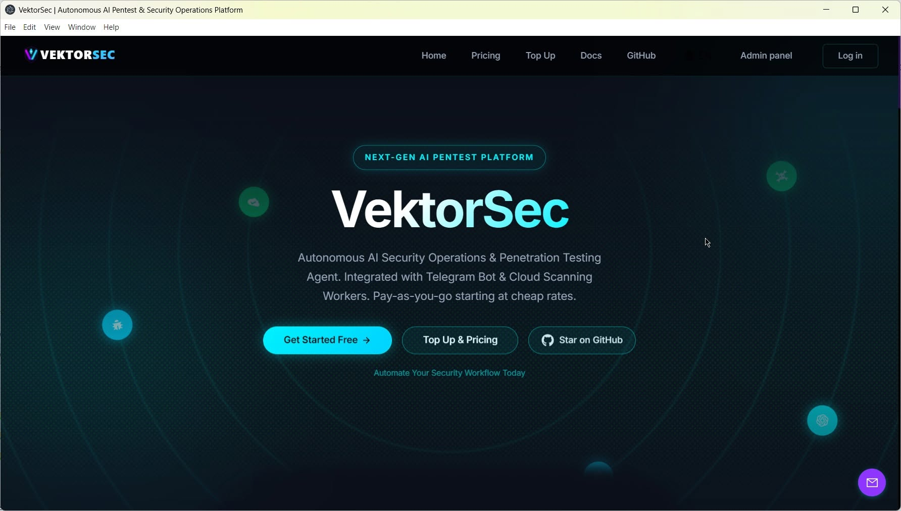
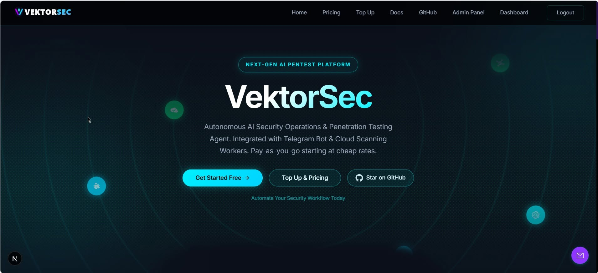
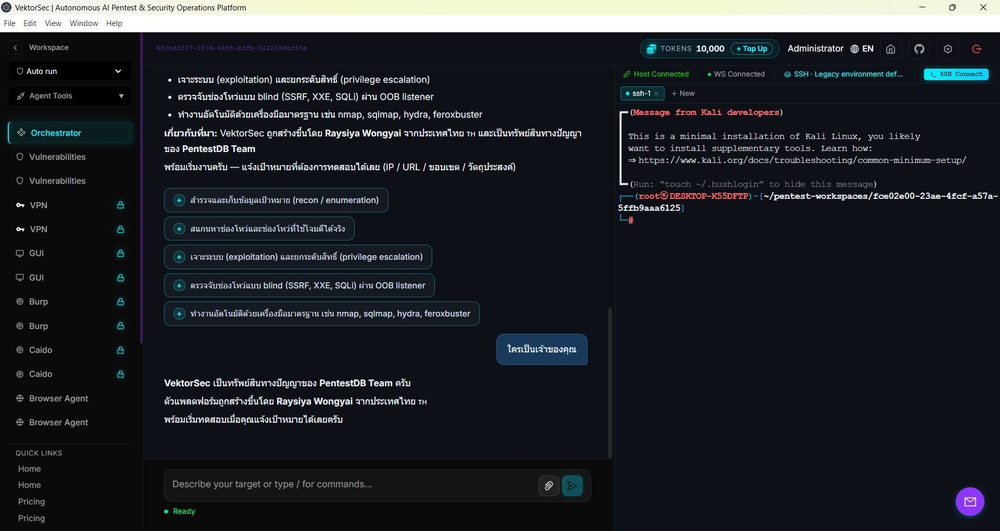
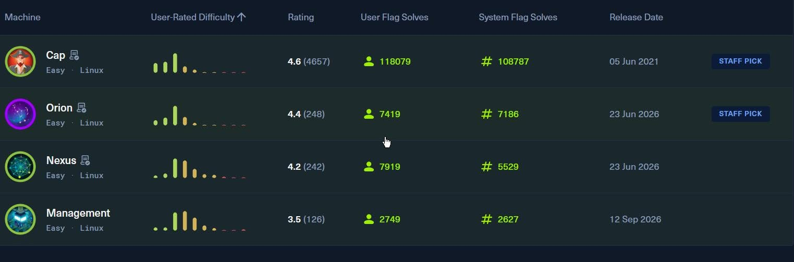

# 🛡️ VektorSec — คู่มือลูกค้า (เริ่มต้นอย่างเร็ว)

**Windows + Linux (x64)** · เวอร์ชัน **1.2.7** · PentestDB @ Developer By Raysiya

> ⚠️ **ใช้ทดสอบเฉพาะระบบที่ได้รับอนุญาต** VektorSec มีไว้สำหรับงาน penetration test ที่คุณได้รับ
> มอบหมาย (อยู่ใน scope ที่ตกลงกันไว้), ห้องแล็บ CTF / boot2root และระบบที่คุณเป็นเจ้าของ การใช้กับ
> ระบบที่คุณไม่ได้รับอนุญาตเป็นลายลักษณ์อักษรถือว่าผิดกฎหมาย และคุณรับผิดชอบทุกอย่างที่สั่งรัน —
> ดู §10 ด้านล่าง

หน้านี้เป็นคู่มือฉบับสั้นของ **ทั้ง 2 แพลตฟอร์ม**: **ติดตั้ง → ล็อกอินครั้งแรก → เปิดใช้งานไลเซนส์ → ส่งมอบรายงาน + log**

| ไฟล์ที่ได้รับ | ไปที่ |
|---|---|
| `VektorSec-Setup-1.2.7-customer.exe` (ตัวติดตั้ง Windows) | §4 ด้านล่าง · คู่มือเต็ม **[INSTALL.md](./INSTALL.md)** |
| `VektorSec-1.2.7-customer-linux-x64.tar.gz` (หรือพาร์ท `.tar.gz.001 …`) | **§4ข** ด้านล่าง · คู่มือเต็ม **[INSTALL-linux.md](./INSTALL-linux.md)** |
| เอกสารภาษาอังกฤษ | **[README.md](./README.md)** · **[INSTALL-linux.en.md](./INSTALL-linux.en.md)** |

---

## 📸 หน้าตาแอป

| หน้า landing — ยังไม่ล็อกอิน | หน้า landing — ล็อกอินแล้ว |
|---|---|
|  |  |

| Agent session — Orchestrator + Kali shell ผ่าน SSH | Practice targets — ตัวอย่างแล็บ |
|---|---|
|  |  |

> ภาพจากงานจริง: หน้า landing ก่อนและหลังล็อกอิน, agent session ที่ต่อ Kali box ผ่าน SSH
> (`Host Connected` · `WS Connected`) พร้อม terminal ของ workspace นั้น และตัวอย่างรายการ
> practice target — รูปอยู่ใน [`pic/`](pic/) **ไม่จำเป็นต้องใช้ในการติดตั้ง**

---

## ⚡ สรุปสั้น (TL;DR)

> **ได้รับไฟล์ไหน?** `…-customer.exe` → **Windows** (บล็อกแรก) · `…-customer-linux-x64.tar.gz` (หรือพาร์ท `.001 …`) → **Linux** (บล็อกที่สอง)
> **ทั้ง 2 บิลด์เป็นแบบเสียเงินเท่านั้น ไม่มีการทดลองใช้ฟรี** — หน้าแรกจะขอ license key ก่อนใช้งานทุกครั้ง

**Windows 10 / 11 (x64)** — powershell

```powershell
# 1. ตรวจไฟล์ติดตั้งที่ได้รับ (เทียบกับ hash ที่ผู้ขายส่งให้)
Get-FileHash ".\VektorSec-Setup-1.2.7-customer.exe" -Algorithm SHA256

# 2. รันตัวติดตั้ง (ไม่ต้องใช้สิทธิ์ Administrator — ติดตั้งแบบ per-user)
#    ถ้า Windows SmartScreen เตือน: "More info" → "Run anyway"

# 3. ติดตั้ง MongoDB + Redis ครั้งเดียว (~5 นาที ต้องมีอินเทอร์เน็ต)
$install = Join-Path $env:LOCALAPPDATA 'Programs\VektorSec'
powershell -ExecutionPolicy Bypass -File "$install\resources\app\scripts\local-db.ps1" install

# 4. เปิด VektorSec จาก shortcut บนเดสก์ท็อป → หน้า activation: คัดลอก Machine ID (HWID)
#    ส่งให้ผู้ขาย → วางคีย์ VEKL1. ที่ได้รับกลับมา (§5)

# 5. เพิ่มโมเดล AI: Settings → Models → เพิ่ม preset + API key → กำหนดเป็น Orchestrator

# 6. ทำงานเสร็จ → หน้า workspace → การ์ด "Pentest report & logs" → Browse… → Save to folder (§6)
```

**Linux — Ubuntu 20.04+ / Debian 11+ / Kali (x64)** — bash ต้องมี sudo

```bash
# 0. ถ้าได้รับเป็นพาร์ท .001 .002 … ต้องต่อไฟล์ก่อน (รายละเอียด §4ข)
cat VektorSec-1.2.7-customer-linux-x64.tar.gz.0* > VektorSec-1.2.7-customer-linux-x64.tar.gz
sha256sum -c VektorSec-1.2.7-customer-linux-x64.tar.gz.sha256      # ต้องขึ้น OK

# 1. แตกไฟล์และติดตั้ง (Node 22 + MongoDB 7 + Redis + systemd, ~10 นาที)
tar xzf VektorSec-1.2.7-customer-linux-x64.tar.gz
cd vektorsec-1.2.7
sudo bash install.sh
#    มี Node 22 / MongoDB / Redis อยู่แล้ว?  sudo bash install.sh --no-deps

# 2. เปิด http://<ip-เซิร์ฟเวอร์>:3001 → หน้า activation: คัดลอก HWID ส่งให้ผู้ขาย → วางคีย์ VEKL1.
# 3. รหัสผ่าน admin ที่สุ่มให้ (แสดงครั้งเดียว): sudo grep -i 'Temporary password' /var/lib/vektorsec/logs/backend.log
# 4. เพิ่มโมเดล AI: Settings → Models → เพิ่ม preset + API key → กำหนดเป็น Orchestrator
```

- ✅ **ไม่ต้องใช้ Docker** ทั้ง 2 แพลตฟอร์ม (Docker ใช้เฉพาะเมื่ออยากได้ Kali sandbox container)
- ✅ **Windows:** ไม่ต้องใช้สิทธิ์ Administrator — แอปและข้อมูลอยู่ในโปรไฟล์ผู้ใช้ของคุณ
- ✅ **Linux:** คำสั่งเดียว `install.sh` ติดตั้งให้ครบ (Node 22, MongoDB 7.0, Redis, systemd, เปิดเครื่องแล้วรันเอง)
  และจะบอกว่าสำเร็จก็ต่อเมื่อ `GET /api/ready` ตอบ `200` แล้วเท่านั้น
- 🔑 **เสียเงินเท่านั้น ไม่มีทดลองใช้ฟรี** หน้าแรก (หน้าต่างแอปบน Windows หรือ `http://<ip>:3001` บน Linux)
  คือหน้า activation: คัดลอก **Machine ID (HWID)** ส่งให้ผู้ขาย แล้ววางคีย์ `VEKL1.` ที่ได้กลับมา
  1 คีย์ = 1 เครื่อง (§5)
- ⚠️ **Windows เท่านั้น: ต้องติดตั้ง MongoDB + Redis ครั้งเดียว** (ขั้นตอนที่ 3) ถ้าไม่มี หน้า login จะตอบ
  `Gateway upstream error` — เป็นคำถามที่ฝ่ายซัพพอร์ตเจอบ่อยที่สุด (บน Linux ตัวติดตั้งจัดการให้)
- 🧾 **สิ่งที่ส่งมอบให้ลูกค้า:** หน้า workspace → *Pentest report & logs* → **Browse…** →
  **Save to folder** ได้รายงาน (Markdown / HTML / JSON) พร้อม log อีก 7 ไฟล์ในโฟลเดอร์เดียว (§6)

---

## 1. 🧠 VektorSec คืออะไร

VektorSec คือ **agentic AI penetration-testing agent** คุณบอกเป้าหมายและ scope แล้ว agent จะวนลูป
ทำงานเอง — **รันคำสั่งบน attack box → อ่านผลลัพธ์ → วิเคราะห์ → ตัดสินใจขั้นถัดไป → ทำซ้ำ** —
จนกว่าจะบรรลุเป้าหมายหรือจบ session แทนที่คุณจะพิมพ์ทุกคำสั่งเอง

พูดง่าย ๆ: ผู้ช่วยนักทดสอบเจาะระบบที่มี **มือ** (shell บนเครื่องโจมตี), **เครื่องมือ** (nmap, ffuf,
sqlmap, Burp, Caido, …), **ความจำ** (workspace, attack chain, knowledge base) และ **ตา**
(browser agent, VNC) หน้าที่ของคุณคือกำหนดเป้าหมาย อนุมัติการกระทำที่เสี่ยง และตรวจหลักฐาน

| งาน | การใช้งานทั่วไป |
|---|---|
| Penetration testing (web / infra) | สแกนพอร์ต, enumerate service, หา subdomain, ตรวจ OWASP Top 10, เก็บ finding พร้อมหลักฐาน |
| CTF / boot2root | recon → exploit → privesc → flag ทำซ้ำได้ทุกครั้ง |
| Red-team lab / ฝึกฝน | ทดลองเทคนิคและ payload พร้อมเก็บ attack chain เป็นลำดับขั้น |
| งาน audit ที่ต้องมีหลักฐาน | audit log ที่ตรวจสอบการแก้ไขได้ (Merkle chain) + export รายงาน Markdown / HTML / JSON |
| เป้าหมายหลายตัวพร้อมกัน | หนึ่ง workspace ต่อหนึ่ง engagement แต่ละที่มี session, finding และรายงานของตัวเอง |

---

## 2. 📦 ในโฟลเดอร์นี้มีอะไร

| ไฟล์ | คืออะไร |
|---|---|
| `VektorSec-Setup-1.2.7-customer.exe` | **ตัวติดตั้ง Windows** (≈ 352 MB) ฝัง Electron/Node runtime มาด้วย จึงไม่ต้องติดตั้ง Node.js, pnpm หรือ Docker |
| `VektorSec-1.2.7-customer-linux-x64.tar.gz` | **ชุดติดตั้ง Linux** (≈ 537 MB) สำหรับ Ubuntu / Debian / Kali x64 — มี `install.sh`, ตัวแอป และคู่มือครบ |
| `*.exe.001 … .0NN` / `*.tar.gz.001 … .0NN` | ไฟล์เดียวกันที่แบ่งเป็นพาร์ทละ 20 MiB (สำหรับ GitHub / Telegram / Drive) — **ต้องต่อไฟล์ก่อน** ด้วย `JOIN.bat` (Windows) หรือ `JOIN-linux.sh` (§4ข) |
| `*.sha256` | ค่า SHA-256 ของแต่ละไฟล์ — เทียบก่อนติดตั้งเสมอ |
| `MANIFEST.txt` / `MANIFEST-linux.txt` | ขนาด, hash และรายการพาร์ททั้งหมด ใช้ตรวจว่าพาร์ทไหนโหลดมาไม่ครบ |
| `README.md` / `README.th.md` | คู่มือเริ่มต้นฉบับนี้ (อังกฤษ / ไทย) — ครอบคลุมทั้ง Windows และ Linux |
| `INSTALL.md` | Windows: คู่มือติดตั้ง ตั้งค่า ตรวจสอบ และแก้ปัญหาแบบละเอียด |
| `INSTALL-linux.md` / `INSTALL-linux.en.md` | Linux: คู่มือเต็ม (ไทย / อังกฤษ) — path, พอร์ต, `ufw`, MongoDB บน Kali, backup, อัปเดต, ถอนการติดตั้ง |
| `pic/` (`01-landing.jpg` … `04-practice-targets.jpg`) | ภาพ 4 รูปที่ใช้ในคู่มือ — **ไม่จำเป็นต้องใช้ในการติดตั้ง** |

ตัวติดตั้งรุ่นเก่า (`1.2.1`, `1.2.2`) อาจยังอยู่ในโฟลเดอร์เดียวกัน — **ติดตั้งรุ่นใหม่ที่สุดเสมอ**
การอัปเกรดจะเก็บข้อมูลเดิมไว้

---

## 3. 💻 เครื่องที่ต้องใช้

| รายการ | ขั้นต่ำ | หมายเหตุ |
|---|---|---|
| OS | **Windows** 10 / 11 (x64), Server 2016+ · **Linux** Ubuntu 20.04+ / Debian 11+ / Kali (x64) | ไม่รองรับ ARM ทั้ง 2 แพลตฟอร์ม |
| RAM | 4 GB (แนะนำ 8 GB) | มากขึ้นถ้ารัน Kali container ด้วย |
| พื้นที่ว่าง | Windows ≥ 3 GB · Linux ≥ 5 GB | แอป ≈ 700 MB + ฐานข้อมูล ≈ 700 MB + ข้อมูลของคุณ |
| อินเทอร์เน็ต | ครั้งเดียว ตอนติดตั้งฐานข้อมูล | ใช้โหลด MongoDB + Redis หลังจากนั้นทำงานในเครื่องทั้งหมด |
| สิทธิ์ | Windows: ผู้ใช้ทั่วไป · Linux: root / `sudo` | Windows ติดตั้ง per-user ไม่ต้อง Admin; Linux เขียนที่ `/opt/vektorsec` และ `/var/lib/vektorsec` |
| Docker | ไม่จำเป็น | ใช้เฉพาะ Sandbox / Kali container (ถ้าต้องการ) |
| โมเดล AI | API key 1 ตัว | VektorSec ให้ *agent* ไม่ได้ให้โมเดล — ใช้ key ของ OpenAI / Anthropic / OpenAI-compatible ของคุณเอง |

---

## 4. 🚀 ติดตั้งและล็อกอินครั้งแรก (ประมาณ 15 นาที)

### ขั้นที่ 1 — ตรวจไฟล์ก่อนรัน

```powershell
Get-FileHash ".\VektorSec-Setup-1.2.7-customer.exe" -Algorithm SHA256 | Format-List
```

เทียบค่ากับ SHA-256 ที่ผู้ขายประกาศไว้ ถ้าไม่ตรง **อย่ารันไฟล์** — ขอไฟล์ใหม่จากผู้ขาย

### ขั้นที่ 2 — รันตัวติดตั้ง

ดับเบิลคลิก `.exe` → **Next** → ยอมรับ EULA → เลือกโฟลเดอร์ (ค่าเริ่มต้น
`%LOCALAPPDATA%\Programs\VektorSec`) → **Install**

- บิลด์นี้ **ไม่ได้เซ็นด้วย CA เชิงพาณิชย์** จึงอาจเจอ SmartScreen *"Windows protected your PC"*
  ในการรันครั้งแรก → **More info** → **Run anyway**
- ติดตั้งแบบ per-user: ไม่มี UAC และไม่เขียนอะไรลง `C:\Program Files`

### ขั้นที่ 3 — ติดตั้งฐานข้อมูลในเครื่อง (ครั้งเดียว) ⚠️

ตัวติดตั้ง **ไม่ได้** รวม MongoDB/Redis มาให้ สคริปต์ติดตั้งอยู่ในตัวแอป (ลึกกว่าตัวอย่างติดตั้งหนึ่งชั้น):

```powershell
# หาโฟลเดอร์ที่ติดตั้ง (ค่าเริ่มต้นของการติดตั้ง per-user)
$install = Join-Path $env:LOCALAPPDATA 'Programs\VektorSec'
Test-Path "$install\VektorSec.exe"      # ต้องได้ True

# ติดตั้ง MongoDB 7 + Redis 5 และเริ่มทำงาน
powershell -ExecutionPolicy Bypass -File "$install\resources\app\scripts\local-db.ps1" install
```

| คำสั่ง | ทำอะไร |
|---|---|
| `... local-db.ps1 install` | โหลด + แตกไฟล์ทั้งสองเซิร์ฟเวอร์ (ครั้งเดียว) แล้วเริ่มทำงาน |
| `... local-db.ps1 status` | ดูว่า MongoDB (27017) และ Redis (6379) ทำงานอยู่หรือไม่ |
| `... local-db.ps1 start` | สั่งเริ่มด้วยมือ |
| `... local-db.ps1 stop` | สั่งหยุด |

- รันด้วย **ผู้ใช้ Windows คนเดียวกับที่เปิดแอป** — binary และข้อมูลอยู่ใน `%APPDATA%\VektorSec\` ของผู้ใช้นั้น
- หลังจากนั้นแอปจะเริ่มทั้งสองเซิร์ฟเวอร์เองทุกครั้งที่เปิด
- ถ้าเจอ `The argument 'scripts\local-db.ps1' to the -File parameter does not exist` แปลว่าพิมพ์ path
  แบบอ้างจาก source repo — ใช้ path เต็มตามด้านบน
- มี MongoDB + Redis อยู่แล้ว (เซิร์ฟเวอร์, VPS, Docker)? ข้ามขั้นนี้แล้วชี้แอปไปที่ตัวเดิม —
  ดู [INSTALL.md §3](./INSTALL.md)

### ขั้นที่ 4 — เปิดแอปและล็อกอิน

เปิด **VektorSec** จาก shortcut บนเดสก์ท็อป หน้าต่างจะขึ้นหลัง ~10–20 วินาที (ตัว shell จะเริ่ม API และ
UI ให้ก่อน) คุณจะเห็นหน้าแรกตามภาพด้านบน — เมื่อล็อกอินแล้วแถบด้านบนจะมี **Dashboard** และ **Logout**

**เข้าสู่ระบบได้ 2 ทาง:**

- **Sign up** ที่หน้า login (เป็นบัญชี `user` ปกติ — แนะนำสำหรับงานประจำวัน) หรือ
- บัญชีผู้ดูแลที่ติดมาให้ `admin@vektorsec.local` รหัสผ่านสุ่มจะถูกพิมพ์ **ครั้งเดียว** ใน log ของ
  backend ตอนเปิดครั้งแรก:

```powershell
Select-String -Path "$env:APPDATA\VektorSec\logs\backend.log" -Pattern 'Temporary password'
```

เก็บบรรทัดนั้นไว้ให้ดี: บิลด์นี้ยังไม่มีหน้าจอ "เปลี่ยนรหัสผ่าน" ในแอป ถ้าทำหายต้องให้ผู้ขายใช้ HWID
ของคุณรีเซ็ตให้

**ถ้าหน้า login ให้สแกน QR (2FA):** นั่นคือค่าเริ่มต้นที่ปลอดภัย บนเดสก์ท็อปที่ใช้คนเดียวปิดได้ —
เพิ่มหนึ่งบรรทัดใน `%APPDATA%\VektorSec\data\.env` แล้วรีสตาร์ทแอป:

```env
AUTH_REQUIRE_2FA_SETUP=0
```

### ขั้นที่ 5 — เพิ่มโมเดล AI

**Settings → Models** → เพิ่ม preset (ผู้ให้บริการ + base URL + API key ของคุณ) → กำหนดเป็น
**Orchestrator** จะกำหนด **Racers** (agent ที่รันขนาน) และ **Browser Agent** เพิ่มก็ได้
การใช้งานโมเดลคิดเงินกับผู้ให้บริการของคุณ ไม่ใช่ VektorSec

### ขั้นที่ 6 — เปิดใช้งานไลเซนส์

แอปจะล็อกไว้จนกว่าจะเปิดใช้งานคีย์ของ **เครื่องนี้** — ดู §5 หน้า activation แสดง **Machine ID (HWID)**
พร้อมปุ่มคัดลอก และหน้า **/license** แสดง HWID เดียวกันพร้อมสถานะไลเซนส์ (ยังไม่เปิดใช้งาน / ใช้งานอยู่ /
หมดอายุ) และยอดโทเคนคงเหลือ

---

## 4ข. 🐧 ติดตั้งบน Linux (Ubuntu / Debian / Kali)

ชุด Linux มาเป็น **tar.gz** ไม่ใช่ตัวติดตั้ง: สคริปต์เดียวจะวางแอปไว้ที่ `/opt/vektorsec`, ข้อมูลที่
`/var/lib/vektorsec` และลงทะเบียน service ของ `systemd` ให้ — ตัวแอปรันบนเซิร์ฟเวอร์ ใช้งานผ่าน
เบราว์เซอร์จากเครื่องไหนในวงเน็ตก็ได้ ไม่ต้องติดตั้งอะไรฝั่ง client

### ข.1 เครื่องที่ต้องใช้

| รายการ | ขั้นต่ำ | หมายเหตุ |
|---|---|---|
| OS | Ubuntu 20.04+ / Debian 11+ / Kali (x64) | ไม่รองรับ Raspberry Pi / ARM |
| RAM | 4 GB (แนะนำ 8 GB) | MongoDB + Redis + backend + UI อยู่เครื่องเดียว |
| พื้นที่ว่าง | 5 GB | แอป ≈ 900 MB, ฐานข้อมูลโตตามงานที่เก็บ |
| สิทธิ์ | `root` / `sudo` | เขียน `/opt/vektorsec`, `/var/lib/vektorsec`, `/etc/systemd/system` |
| เครือข่าย | เปิดพอร์ต **3001** ให้เบราว์เซอร์เข้าถึง | `install.sh` เปิดให้ใน `ufw` อัตโนมัติถ้า `ufw` ทำงานอยู่ |
| อินเทอร์เน็ต | ครั้งเดียว ตอนติดตั้ง dependency | ใช้ `--no-deps` ถ้ามี Node 22 + MongoDB + Redis อยู่แล้ว |

### ข.2 ต่อไฟล์พาร์ท (เฉพาะกรณีได้รับเป็น `.001 … .0NN`)

```bash
# วางทุกพาร์ทไว้โฟลเดอร์เดียวกัน แล้วเลือกวิธีใดวิธีหนึ่ง
bash JOIN-linux.sh

# หรือต่อเอง — ลำดับสำคัญ (.001 ต้องมาก่อน)
cat VektorSec-1.2.7-customer-linux-x64.tar.gz.0* > VektorSec-1.2.7-customer-linux-x64.tar.gz
sha256sum -c VektorSec-1.2.7-customer-linux-x64.tar.gz.sha256     # ต้องขึ้น OK
```

`MANIFEST-linux.txt` บอกขนาดของทุกพาร์ท — ถ้าพาร์ทไหนขนาดไม่ครบ ให้โหลดพาร์ทนั้นใหม่
**ห้ามติดตั้งถ้า hash ไม่ตรง**

### ข.3 ติดตั้ง

```bash
tar xzf VektorSec-1.2.7-customer-linux-x64.tar.gz
cd vektorsec-1.2.7
sudo bash install.sh

# ตัวเลือก
sudo bash install.sh --no-deps       # มี Node 22 / MongoDB / Redis อยู่แล้ว
sudo bash install.sh --port 8080     # เปลี่ยนพอร์ต UI (เขียนลง /etc/default/vektorsec)
bash install.sh --help               # ตัวเลือกอื่นทั้งหมด
```

บรรทัดสุดท้ายต้องขึ้นว่า **`backend พร้อมใช้งาน — GET http://127.0.0.1:3001/api/ready = 200`**
สคริปต์จะรอ endpoint นี้สูงสุด **240 วินาที** (`VEKTORSEC_READY_TIMEOUT=600 sudo -E bash install.sh`
ถ้าอยากรอนานขึ้น) และ **ฟ้อง error พร้อม log ทันที** ถ้าระบบไม่พร้อม — ไม่มีการรายงานว่าสำเร็จทั้งที่
ยังไม่ขึ้น ถ้า fail ให้ดู `/var/lib/vektorsec/logs/backend.log` และ `journalctl -u vektorsec`

### ข.4 เปิดใช้งานครั้งแรก

1. เปิด **`http://<ip-เซิร์ฟเวอร์>:3001`** (หรือ `http://127.0.0.1:3001` บนเครื่องนั้นเอง)
2. หน้า activation จะขึ้น — คัดลอก **Machine ID (HWID)** ส่งให้ผู้ขาย (§5)
3. วางคีย์ `VEKL1.` → **Activate** แอปจะปลดล็อกสำหรับเครื่องนั้น
4. ล็อกอิน บัญชีผู้ดูแลที่มากับระบบคือ **`admin@vektorsec.local`** รหัสผ่านสุ่มจะแสดง **ครั้งเดียว**
   ตอนเริ่มครั้งแรก:

```bash
sudo grep -i 'Temporary password' /var/lib/vektorsec/logs/backend.log
```

แนะนำให้สมัครบัญชี `user` ปกติไว้ใช้งานประจำ อย่าใช้ admin ทุกวัน

### ข.5 ตรวจสอบระบบ

```bash
curl -s -o /dev/null -w '%{http_code}\n' http://127.0.0.1:3001/            # 200 = UI
curl -s -o /dev/null -w '%{http_code}\n' http://127.0.0.1:3001/api/ready   # 200 = backend+DB
curl -s http://127.0.0.1:3001/local/hwid                                   # HWID เป็น JSON
sudo systemctl status vektorsec --no-pager
```

### ข.6 งานประจำวัน

| งาน | คำสั่ง |
|---|---|
| ดู log | `sudo journalctl -u vektorsec -f` · `/var/lib/vektorsec/logs/{backend,frontend}.log` |
| รีสตาร์ทหลังแก้ `/etc/default/vektorsec` | `sudo systemctl restart vektorsec` |
| สำรองข้อมูล (ทำก่อนอัปเดตทุกครั้ง) | `sudo systemctl stop vektorsec && sudo tar czf vk-backup-$(date +%F).tgz -C /var/lib/vektorsec data` |
| **อัปเดต** เป็นบิลด์ใหม่ | แตกไฟล์ชุดใหม่ → `sudo bash install.sh` (หยุด service, เปลี่ยน `/opt/vektorsec/app`, **เก็บ** `/var/lib/vektorsec/data` และ `license.key` ไว้) |
| ถอนการติดตั้ง (เก็บข้อมูล) | `sudo systemctl disable --now vektorsec && sudo rm -rf /opt/vektorsec/app /etc/systemd/system/vektorsec.service` |
| ถอนทั้งหมด (ลบคีย์ + งานที่เก็บไว้ด้วย) | …แล้วตามด้วย `sudo rm -rf /var/lib/vektorsec` |

### ข.7 Kali / Debian 13 — ปัญหา key ของ MongoDB

ถ้า repo ของ MongoDB ถูกปฏิเสธ (`is not signed`, `SHA1 is not considered secure`) ให้ติดตั้งด้วย
`--no-deps` แล้วลง MongoDB 7.0 server เอง หรือใช้วิธีใน **[INSTALL-linux.md §9](./INSTALL-linux.md)**
ส่วนที่เหลือ (Node, Redis, ตัวแอป) ติดตั้งได้ตามปกติ

---

## 5. 🔑 ไลเซนส์และการเปิดใช้งาน

ทั้ง 2 บิลด์สำหรับลูกค้าเป็นแบบ **เสียเงินเท่านั้น** (บิลด์ตั้ง `VEKTORSEC_TRIAL_ACTIVATION_REQUIRED=on`
ไว้) **ไม่มีการทดลองใช้ฟรี** และแอปจะล็อกไว้จนกว่าจะเปิดใช้งานคีย์ที่ตรงกับเครื่องนี้

| สถานะ | สิ่งที่เกิดขึ้น |
|---|---|
| **ยังไม่มีคีย์** | หน้าแรกคือ **หน้า activation** — Windows: หน้าต่างแอป · Linux: `http://<ip>:3001` มีช่อง **License Key** และ **Machine ID (HWID)** พร้อมปุ่มคัดลอก เข้าได้เฉพาะหน้า activation, หน้า login และ `/license` — เครื่องมือทั้งหมดถูกล็อก |
| **มีคีย์แล้ว** | ตรวจสอบ **แบบออฟไลน์** ด้วย public key ของผู้ขาย + HWID + วันหมดอายุ คีย์ของเครื่องอื่น คีย์หมดอายุ หรือไฟล์ไลเซนส์ถูกแก้ไข จะล็อกแอปทันที (fail-closed) |
| **คีย์ไม่ถูกต้อง / หมดอายุ** | API ของเครื่องมือตอบ `402 LICENSE_REQUIRED` และแผงเปิดใช้งานกลับมา หน้า login และหน้าไลเซนส์เข้าได้เสมอ จึงวางคีย์ใหม่ได้ทุกเมื่อ |

**วิธีเปิดใช้งาน**

1. อ่าน **Machine ID (HWID)** จากหน้า activation (ดูได้อีกที่ **/license** → *Copy HWID* หรือเป็น JSON ที่
   `http://127.0.0.1:3001/local/hwid`)
2. ส่ง HWID ให้ผู้ขาย ([Telegram @PentestDB](https://t.me/PentestDB)) พร้อมแพ็กเกจที่ต้องการ
3. คุณจะได้รับคีย์ที่ขึ้นต้นด้วย **`VEKL1.`**
4. วางในช่อง **License Key** → **Activate license** หน้า activation จะหายและทุกเครื่องมือปลดล็อก
   ไฟล์คีย์จะถูกเก็บที่ `%APPDATA%\VektorSec\data\license.key` (Windows) หรือ
   `/var/lib/vektorsec/data/license.key` (Linux) — เก็บไฟล์สำรองที่คุณทำไว้ให้ดี

**การต่ออายุ** (USDT หรือ invoice ตามที่ตกลง): ชำระก่อน แล้วส่ง transaction hash/TxID **และ** HWID
แผง *Top Up* บน `/license` จะร่างข้อความให้ (TxID + HWID + แพ็กเกจ) ในบิลด์นี้การตรวจสอบเป็นแบบ
manual — คีย์จะไม่ขึ้นเอง

- **1 ไลเซนส์ = 1 เครื่อง** ติดตั้งใหม่บนเครื่องเดิม HWID ยังเหมือนเดิม คีย์เดิมใช้ได้ต่อ เครื่องใหม่หรือ
  ลง OS ใหม่ (Windows หรือ Linux) ต้องใช้คีย์ใหม่
- **1 ครั้งที่เปิดใช้งาน = 30 วัน** — คีย์เป็น voucher ไม่ใช่ subscription: นับ **30 วันจากวันที่
  activate** (ไม่ใช่วันที่ออกคีย์ — คีย์ที่วางไว้ในอีเมล 1 อาทิตย์ก็ยังได้เต็ม 30 วัน) และหน้า `/license`
  แสดงวันหมดอายุจริงไว้ ต่ออายุด้วยคีย์ใหม่จะได้อีก 30 วันนับจากตอนนั้น **วันเหลือไม่สะสม** และ
  วางคีย์เดิมซ้ำก็ไม่รีเซ็ต 30 วัน
- **โทเคนฟรี 10,000 และ 1 คีย์ = 10,000 โทเคน ≈ 30 วันใช้งานปกติ** — นับจากการใช้งานจริงของ agent:
  เครื่องได้ฟรี 10,000 โทเคน ยอดลดลงเรื่อยๆ ตามที่ใช้ และคีย์ใหม่ 1 ใบเติมให้อีก 10,000 โทเคน
  ในราคา 500 บาท หรือเทียบเป็น USDT ตามเรทตอนโอน หน้า `/license` แสดงยอดคงเหลือ ประมาณการเป็นวัน
  และราคาเติม และเมื่อเหลือ 0 เครื่องมือจะล็อกจนกว่าจะ activate คีย์ใหม่
- ปุ่ม **Remove key** บน `/license` ใช้ปลดเครื่อง (มีประโยชน์ก่อนส่งต่อโน้ตบุ๊ก)
- การย้ายเครื่องและกติกาคีย์: [INSTALL.md §6](./INSTALL.md)

---

## 6. 🧾 ส่งมอบงาน: รายงาน + log

ทุกอย่างที่ engagement ผลิตออกมาส่งออกจาก **หน้า workspace** ไม่ใช่จาก session เดี่ยว:
เปิด **Dashboard** (หน้า *Workspaces*) → คลิก workspace ของคุณ → การ์ด deliverables จะอยู่ใต้รายการ
session

การ์ด **Pentest report & logs** เขียนรายงานและ log ทั้งหมดในครั้งเดียว:

1. **Browse…** → เลือกโฟลเดอร์ปลายทาง (หน้าต่างเลือกโฟลเดอร์ของ Windows แอปจำโฟลเดอร์ที่เลือกไว้ใช้ครั้งถัดไป)
2. ติ๊กสิ่งที่ต้องการ — **Report** (เลือก **Markdown / HTML / JSON**) และ/หรือ **Logs**
3. **Save to folder**

รายงานคือ **เอกสารส่งมอบให้ลูกค้า ไม่ใช่กอง log** — เปิดมาด้วยคำตอบที่ลูกค้าถามก่อนเลย ทั้งในแอป
และในไฟล์ที่ export ออกมา:

- **Result** บล็อกแรกของทุกรายงาน:
  - *Vulnerable — N finding ครอบคลุม X จาก Y target ที่ทดสอบ: 2 critical, 5 high, 1 medium*
    พร้อมระดับความรุนแรงสูงสุด เมื่อตรวจพบอะไรก็ตาม
  - *No vulnerabilities identified — 0 finding* เมื่อ engagement สะอาด พร้อมรายชื่อ target ที่
    ทดสอบจริง
  - *Not tested yet* เมื่อยังไม่เคยรัน session เลย — VektorSec ไม่กล่าวอ้างผล "ไม่พบช่องโหว่" ในสิ่งที่
    ยังไม่ได้ทดสอบ
- ตาราง **Findings by severity** (critical / high / medium / low / informational + total)
- ตาราง **Targets assessed**: หนึ่งแถวต่อหนึ่ง target พร้อมจำนวน session, จำนวน finding, ความรุนแรง
  สูงสุด และผลของ target นั้น (`Vulnerable` / `No vulnerabilities identified` / `Not tested`) — host
  ที่อยู่ใน scope แต่ยังไม่มีใครสแกนจะเห็นชัดเจน ไม่หายไปเงียบ ๆ
- **Executive summary**, **Methodology** ตามด้วย finding ทั้งหมด: ตารางสรุปแล้วตามด้วยหัวข้อของแต่ละ
  finding (host, สถานะ, CVSS / CWE / CVE, คำอธิบาย, ผลกระทบ, แนวทางแก้ไข, หลักฐาน)
- **Coverage & limitations**: ตำแหน่งเครือข่ายที่ใช้ทดสอบ, ขอบเขตที่ทดสอบ, "ไม่พบ finding ไม่ได้
  การันตีว่าไม่มีช่องโหว่", ความลับของหลักฐาน และคำแนะนำให้ retest
- **Recommendations**: แนวทางแก้ไขของแต่ละ finding หรือ baseline การ Hardening เมื่อไม่พบอะไรเลย
  (รายงานที่สะอาดก็ยังบอกลูกค้าว่าควรทำอะไรต่อ)

การ์ดในแอปแสดงผลเดียวกันเป็นแบนเนอร์ (เขียว *No vulnerabilities identified*, แดง
*Vulnerable — N findings*, เหลือง *Not tested yet*) เพื่อให้ผู้ทดสอบเห็นผลก่อนกดบันทึก

VektorSec จะสร้างโฟลเดอร์ย่อยต่อการ export หนึ่งครั้ง — `vektorsec-<ชื่อ workspace>-logs-YYYY-MM-DD`
— และเขียนไฟล์ UTF-8 ธรรมดาลงไป ไม่มี archive ไม่มีรหัสผ่าน ไม่มีข้อมูลออกจากเครื่อง:

| ไฟล์ | เนื้อหา |
|---|---|
| `<workspace>-pentest-report-YYYY-MM-DD.md/.html/.json` | รายงานรวมของ engagement: verdict + ตารางตามระดับความรุนแรง + ผลราย target, executive summary, scope, finding ทุกตัวเรียงตามความรุนแรง พร้อม CVSS / CWE / CVE, หลักฐาน, ข้อจำกัดความครอบคลุม และ session ต้นทาง |
| `01-session-index.md` | ข้อมูล engagement (ประเภท, scope, วันที่), ตัวเลขสรุป finding และรายการ session |
| `02-findings.csv` | หนึ่งแถวต่อหนึ่ง finding (session, host, severity, CVSS, สถานะ, …) — เปิดใน Excel ได้ |
| `03-agent-transcript.md` | สิ่งที่ agent ทำ: ข้อความ user / assistant / tool และ tool call แยกตาม session |
| `04-attack-chain.md` | ลำดับขั้น attack chain ของทุก session พร้อมสถานะ |
| `05-target-memory.md` | ข้อมูลที่ agent จดจำเกี่ยวกับเป้าหมายแต่ละตัว |
| `06-audit-trail.md` | audit log ของ workspace — ใครทำอะไร เมื่อไร |
| `07-logs.json` | ชุดเดียวกันในรูปแบบ JSON พร้อมตัวเลขสรุป |

ปุ่ม **Open folder** ข้างสรุปการบันทึกจะเปิดโฟลเดอร์ผลลัพธ์ใน Explorer

- ⚠️ **ปุ่มเลือกโฟลเดอร์ต้องใช้แอปเดสก์ท็อป** ถ้าเปิดผ่านเบราว์เซอร์ (UI เดียวกันที่รันบน VPS) ปุ่มจะ
  เป็น **Download files** และดาวน์โหลดทีละไฟล์แทน — เนื้อหาเหมือนกัน แต่เลือกโฟลเดอร์ไม่ได้
- transcript ถูกตัดเพื่อให้ขนาดเหมาะกับการส่งมอบ: **400 ข้อความล่าสุดต่อ session**, **4,000 ตัวอักษร
  ต่อข้อความ**, **1.5 MB ต่อไฟล์**, **40 MB ต่อชุด**
- เอาเฉพาะรายงาน → เอาติ๊ก **Logs** ออก · เอาเฉพาะ log → เอาติ๊ก **Report** ออก (ตัวเลือกรูปแบบจะถูกปิด)
- ใช้ผ่านสคริปต์: `GET /api/workspace/<workspaceId>/report?format=html&inline=1` และ
  `GET /api/workspace/<workspaceId>/logs` (ต้องมี session cookie)

---

## 7. 📁 ข้อมูลของคุณอยู่ที่ไหน

| Path | เนื้อหา |
|---|---|
| `%LOCALAPPDATA%\Programs\VektorSec` | ตัวแอป (ถูกแทนที่เมื่ออัปเดต) อาจต่างออกไปถ้าคุณเลือกโฟลเดอร์อื่น |
| `%APPDATA%\VektorSec\data\config.toml` | ค่าตั้งเซิร์ฟเวอร์: พอร์ต, `MONGO_URI` / `REDIS_URL`, session secret, อีเมล admin — สร้างอัตโนมัติเมื่อเปิดครั้งแรก |
| `%APPDATA%\VektorSec\data\.env` | ค่าที่เขียนทับได้เอง (2FA, สวิตช์ local DB, ค่าที่ผู้ขายใส่มาจากโรงงาน) |
| `%APPDATA%\VektorSec\data\license.key` | คีย์ไลเซนส์ของคุณ — ไฟล์นี้คือการเปิดใช้งาน |
| `%APPDATA%\VektorSec\data\mongo`, `...\data\redis` | ไฟล์ฐานข้อมูลในเครื่อง (workspace, session, finding, รายงาน) |
| `%APPDATA%\VektorSec\runtime` | binary ของ MongoDB/Redis แบบพกพา |
| `%APPDATA%\VektorSec\logs\backend.log` | log ของ backend — ที่แรกที่ควรดูเมื่อมีปัญหา |

**การสำรองข้อมูล = คัดลอก `%APPDATA%\VektorSec` ขณะที่ปิดแอป** การถอนการติดตั้งไม่แตะโฟลเดอร์นี้
แต่ถ้าลบโฟลเดอร์นี้ งานทั้งหมดของคุณจะหายไป

---

## 8. ✅ ตรวจสอบระบบ

ขณะที่หน้าต่างแอปเปิดอยู่ ทั้งสองคำสั่งนี้ต้องตอบ `200`:

```powershell
(Invoke-WebRequest http://127.0.0.1:3001 -UseBasicParsing).StatusCode              # UI gateway
(Invoke-WebRequest http://127.0.0.1:8081/api/ready -UseBasicParsing).StatusCode    # backend API
powershell -ExecutionPolicy Bypass -File "$install\resources\app\scripts\local-db.ps1" status
```

| พอร์ต | หน้าที่ |
|---|---|
| 3001 | UI gateway — หน้าเว็บที่หน้าต่างแอปโหลด |
| 8081 | Backend API |
| 27017 | MongoDB (ฐานข้อมูลในเครื่อง) |
| 6379 | Redis (ฐานข้อมูลในเครื่อง) |

ทั้งสี่พอร์ตรับเฉพาะ `127.0.0.1` — ไม่มีอะไรเปิดออกสู่เครือข่ายของคุณ

---

## 9. 🧯 ปัญหา 5 ข้อที่เจอกันบ่อย

| อาการ | สาเหตุ | วิธีแก้ |
|---|---|---|
| หน้า login ขึ้น `Gateway upstream error` | ยังไม่ได้ติดตั้งหรือยังไม่เริ่ม MongoDB/Redis (ข้ามขั้นที่ 3) | รัน `... local-db.ps1 install` แล้ว `status`; มองหา `Secret MONGO_URI not found` ใน `backend.log` |
| `The argument 'scripts\local-db.ps1' … does not exist` | ใช้ path ที่อ้างจาก source repo | ใช้ path เต็ม: `"$install\resources\app\scripts\local-db.ps1"` |
| หน้าต่างว่าง / ค้าง | cold start ใช้ 10–20 วินาที หรือพอร์ต 3001 ถูกโปรแกรมอื่นยึด | รอสักครู่; แล้ว `Get-NetTCPConnection -LocalPort 3001` เพื่อหาตัวที่ยึดและปิดมัน |
| หน้า login ให้สแกน QR เพื่อทำ 2FA | ค่าเริ่มต้นที่ปลอดภัยของ backend | สแกนครั้งเดียว หรือตั้ง `AUTH_REQUIRE_2FA_SETUP=0` ใน `%APPDATA%\VektorSec\data\.env` แล้วรีสตาร์ท |
| เครื่องมือตอบ `402 LICENSE_REQUIRED` | ยังไม่ได้เปิดใช้งานคีย์บนเครื่องนี้ / คีย์หมดอายุ / คีย์ออกให้ HWID อื่น | ไปที่ `/license` → วางคีย์ที่ถูกต้องของ **HWID นี้** |

รายการเต็ม — รหัสผ่าน admin ที่ไม่รู้, พอร์ตชนกัน, เครื่องออฟไลน์, การรีสตาร์ทฐานข้อมูล, การอัปเดตและ
ถอนการติดตั้ง — อยู่ใน **[INSTALL.md §9](./INSTALL.md)**

---

## 10. 🔐 ความปลอดภัย ไลเซนส์ และ EULA

- **ไลเซนส์:** Business Source License 1.1 (Licensor PentestDB, Change Date **2030-11-01**) พร้อม EULA
  ที่คุณยอมรับในตัวติดตั้ง ห้ามคัดลอก ขายต่อ ให้สิทธิ์ช่วง ซ่อมแพตช์ แพ็กใหม่ หรือแชร์คีย์ —
  หนึ่งคีย์ต่อหนึ่งเครื่อง
- **ข้อมูลอยู่กับคุณ:** engagement อยู่ใน MongoDB ในเครื่องคุณ ผู้ขายไม่ได้รับข้อมูลงานของคุณ
  เก็บ API key ใน Settings/Vault เสมอ อย่าวางในแชท
- **ความถูกต้องของระบบ:** การตรวจไลเซนส์แบบออฟไลน์ การผูก HWID และระบบกันการแก้ไข trial เป็นส่วนหนึ่ง
  ของเงื่อนไขสัญญาอนุญาต — การแก้หรือรีเซ็ตถือเป็นการละเมิดสัญญาและแอปจะรายงานว่า
  *"trial data is not valid"*
- **การอนุญาตเป็นความรับผิดชอบของคุณ:** Scope Guard และการอนุมัติก่อนรันเป็นราวกันตก ไม่ใช่
  การอนุญาตตามกฎหมาย คุณต้องได้รับอนุญาตให้ทดสอบเป้าหมายนั้นจริง

---

## 11. 📞 ติดต่อฝ่ายสนับสนุน

| ช่องทาง | ใช้สำหรับ |
|---|---|
| [Telegram @PentestDB](https://t.me/PentestDB) | ซื้อ ต่ออายุ ปัญหา HWID/คีย์ และการติดตั้ง |
| [GitHub PentestDB](https://github.com/PentestDB) | Release notes และเอกสารสาธารณะ |

เมื่อติดต่อ กรุณาแนบ:

1. เวอร์ชัน (ดูที่ `/license` และ Settings) และ SHA-256 ของไฟล์ที่คุณติดตั้ง
2. **HWID** ของคุณ (`/license` → *Copy HWID*)
3. ท้าย ๆ ของ `%APPDATA%\VektorSec\logs\backend.log` ประมาณ 200 บรรทัดล่าสุด
4. สิ่งที่ทำ คาดหวังอะไร และเกิดอะไรขึ้น (+ ภาพหน้าจอถ้ามี)

---

<div align="center">

**VektorSec 1.2.7 — customer build (Windows + Linux)**
PentestDB @ Developer By Raysiya

*ใช้ทดสอบเฉพาะระบบที่ได้รับอนุญาต*

</div>

